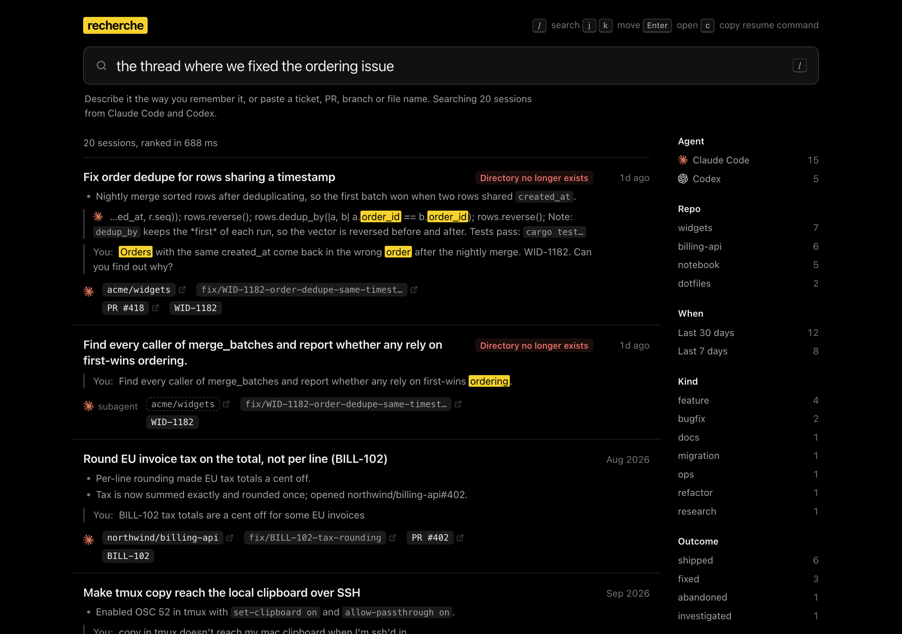
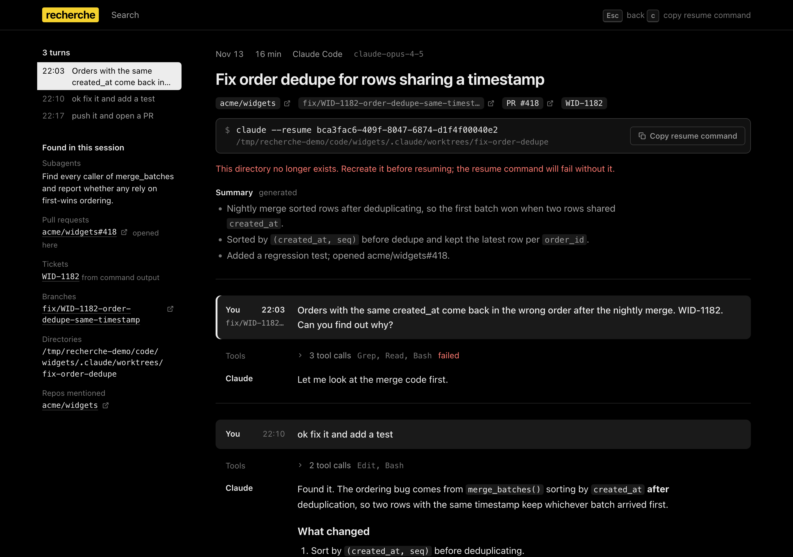

# recherche

Search your past Claude Code and Codex sessions by what you remember: a few
words, a ticket, a pull request, a branch, or a sentence like “the thread where
we fixed the ordering issue.”

recherche runs on your machine as one Rust binary, with a browser UI and a
command-line interface. It reads the session files your agents already write,
keeps a local archive, and combines keyword search with local models that find
similar meaning. No API key is needed for that workflow.



## What you can do

- Find work across Claude Code and Codex without remembering which agent you used.
- Search by prompts, replies, commands, errors, files, tickets, PRs, or branches.
- Read a transcript, follow related sessions, and copy a command to resume it.
- Keep imported sessions searchable after their original files or worktrees disappear.
- Optionally add generated titles, summaries, and query expansion through an
  LLM API.



The screenshots show made-up sessions from `recherche demo`.

This is a personal session search tool. Repository and PR information comes
from recorded sessions; recherche does not crawl your repositories or fetch
their current state from GitHub. An archived transcript remains readable even
when its working directory is gone, but resuming still depends on the original
agent and its session data.

## Get started

Install a published release with Homebrew:

```sh
brew install manojkarthick/tap/recherche
recherche serve
```

Prebuilt ZIP archives and SHA-256 checksums are also available on the
[GitHub Releases page](https://github.com/manojkarthick/recherche/releases).
They support Apple Silicon macOS 15+, and x86_64/ARM64 Linux on Ubuntu 24.04
or compatible newer systems. Extract the archive and put `bin/recherche` on
your `PATH`. Linux needs glibc, libstdc++, OpenSSL 3 and CA certificates;
on Ubuntu install `libc6 libstdc++6 libssl3t64 ca-certificates`.

### Build from source

You need a recent stable Rust toolchain and native build tools: Xcode Command
Line Tools on macOS, or a C/C++ build toolchain on Linux. Service installation
supports macOS and Linux; the ingestion code uses Unix filesystem APIs.

From a checkout of this repository:

```sh
cargo install --path . --locked
recherche serve
```

Cargo installs the binary into `~/.cargo/bin` by default; make sure that directory
is on your `PATH`. To run directly from the checkout instead:

```sh
cargo build --release --locked
./target/release/recherche serve
```

Open <http://127.0.0.1:7777>. No configuration file is required. By default,
recherche imports JSONL session files from:

| Agent | Locations |
| --- | --- |
| Claude Code | `~/.claude/projects/`, including subagent sessions |
| Codex | `~/.codex/sessions/` and `~/.codex/archived_sessions/` |

`CLAUDE_CONFIG_DIR` and `CODEX_HOME`, or explicit source settings, can change
these roots. See [configuration](docs/configuration.md).

The server starts an initial import in the background and keeps watching for
changes. Keyword results become available before embedding finishes. Local
models download on first use into `~/.cache/recherche/models/` by default;
allow network access for those downloads and extra time for the initial import.
Once the models are cached, local search can run offline.

## Try a search

In the browser, enter a sentence, an identifier, or a query with filters:

```text
the thread where we fixed the ordering issue
PROJ-123
repo:example agent:codex since:30d
branch:fix-login kind:bugfix outcome:fixed
```

Keyword results appear first. Semantic retrieval and a local reranker then
update their order. `kind` and `outcome` filters require generated session
summaries. Open a result to read the conversation and inspect its recorded
commands and related entities.

Press `/` to focus search, `j`/`k` to select a result, `Enter` to open it, and
`c` to copy its resume command. The browser copies the command for you to run
in a terminal.

The same archive is available from the CLI:

```sh
recherche search "the thread where we fixed the ordering issue"
recherche search "PROJ-123" --json
recherche list --limit 25 --since 7d
```

See the [usage guide](docs/usage.md) for all commands, query syntax, and ranking
evaluation.

## Data and optional API features

The archive, database, and keyword index live under
`~/.local/share/recherche/` by default, including on macOS. Importing copies
session files; it does not move or delete the originals. Deleting an original
session does not remove recherche's archived copy.

Keyword search, embeddings, and reranking run locally. With an API key present,
the default configuration also enables two optional API features:

| Feature | Data sent to the configured API |
| --- | --- |
| Query expansion | Your query and a list of known repository names |
| Session summaries | A capped digest containing prompts, metadata, selected errors, and the final reply |

The default API is OpenRouter. Query expansion can run automatically for
sentence-like browser searches with weak results; CLI searches require
`--rewrite`. Automatic summaries cover eligible sessions started after the first
`serve` run. Summarizing older sessions requires `recherche summarize`.

To explicitly disable both API features, add this to your config:

```toml
[llm]
enabled = false
```

See [configuration and API setup](docs/configuration.md) for paths, credentials,
source exclusions, service setup, and the data retained locally.

## Documentation

| Guide | What it explains |
| --- | --- |
| [Usage](docs/usage.md) | Search syntax, browser controls, CLI commands, summaries, and evaluation |
| [Configuration and operation](docs/configuration.md) | File locations, settings, optional API calls, background services, and troubleshooting |
| [Architecture](docs/architecture.md) | Architecture diagram, import and search flows, storage, and source-code map |
| [Releasing](docs/releases.md) | Binary publishing and Homebrew token setup |
| [HTTP API](docs/api.md) | Client-independent JSON API for search, sessions, transcripts, and entity navigation |
| [Example configuration](config.example.toml) | Copyable settings with defaults |

## Development

The UI templates and static assets are embedded in the binary. There is no
separate frontend build or database server to start. Rebuild the binary after
changing templates or assets.

CI runs these checks:

```sh
cargo fmt --check
cargo clippy --locked --all-targets -- -D warnings
cargo test --locked
```

To try UI changes or take screenshots without your own sessions, run
`cargo run -- demo`. It serves made-up Claude Code and Codex sessions from
[`demo/sessions/`](demo/) on <http://127.0.0.1:7778>, where each file is one
session; see [demo/README.md](demo/README.md) to add more.

Tests do not require session data, model downloads, or an API key. Building the
dependencies can still require network access, including for ONNX Runtime.
