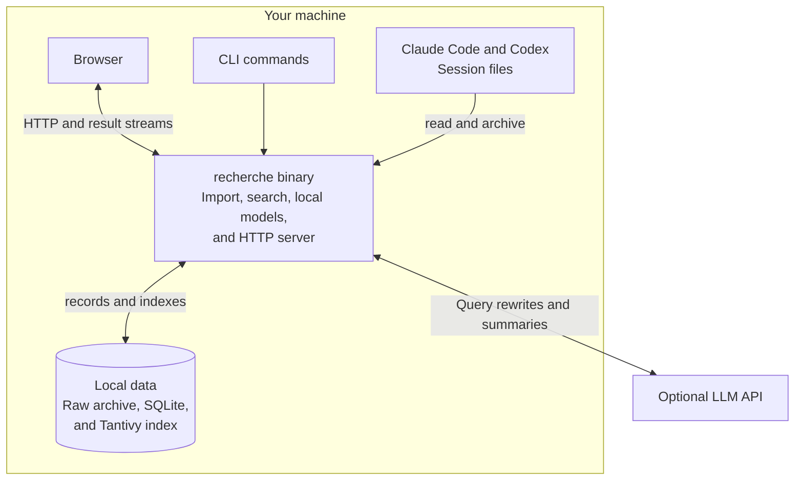
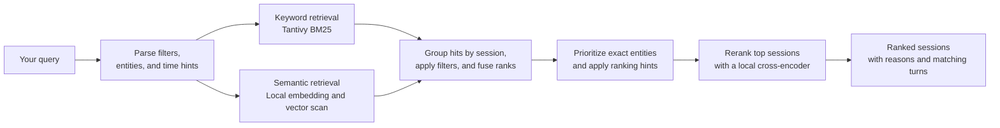

# Architecture

[Back to the README](../README.md) · [Usage](usage.md) · [Configuration](configuration.md)

recherche turns the session files written by Claude Code and Codex into a
searchable personal archive. It is one application with two interfaces: a CLI
and a browser UI. SQLite, the keyword index, and local inference all run inside
the application; there is no separate database, vector service, or frontend
server to operate.

## System overview

The diagram shows the application, its inputs, and its persistent data. Local
models run inside the binary. The optional API may be a remote provider or
another OpenAI-compatible endpoint you configure.

`serve` starts the HTTP server and a background indexing thread in the same
process. CLI commands open the same stores, so searching and listing do not
require the web server. Both interfaces use the same query parser and ranking
engine.

## From session files to searchable data

1. **Discover and archive.** The importer scans Claude Code's `projects/` and
   Codex's `sessions/` and `archived_sessions/` directories for JSONL files.
   It tracks file size, modification time, inode, and a prefix hash. Growing
   files normally append new bytes to the archive; replaced or truncated files
   are copied in full. Originals are read, not modified.
2. **Parse into a common format.** Source-specific parsers produce a
   `ParsedSession`, containing turns, tool calls, timestamps, working
   directories, and recorded facts. Changed files are reparsed in full, using
   only complete newline-terminated records. Malformed JSON lines are counted
   and skipped. Recognized automatic Codex approval-review sessions are marked
   to be excluded from search.
3. **Recover context.** Entity extraction finds repos, branches, worktrees,
   PRs, tickets, commits, and files in recorded metadata, prompts, commands, and
   output. Repository assignment prefers stronger recorded or parsed evidence,
   then information from other sessions in the same directory, then a name
   inferred from the path. It does not require the checkout to still exist.
4. **Store normalized records.** SQLite stores sessions, ordered turns, tool
   details, extracted entities, and source-to-archive tracking. Changed sessions
   are marked dirty for indexing. Parent identifiers preserve recorded agent
   relationships.
5. **Build keyword documents.** Tantivy receives a document per searchable
   turn and a card per session. A card is text assembled from titles, recaps,
   summaries, categories, and entities. Repeated prompt paragraphs are removed
   from indexed prompt text, and replayed or forked turns are deduplicated for
   retrieval. The original transcript text remains in storage.
6. **Embed missing content.** The local embedder creates vectors for cleaned
   prompt/reply text and session cards. Vectors are keyed by content hash in
   SQLite, so unchanged content can reuse an existing embedding. Keyword
   indexing completes before this work starts.

The background thread combines filesystem notifications with polling, which
catches changes missed by notifications. The default poll interval is 30
seconds, with a five-second minimum. Watcher events are debounced for 1.5
seconds. Embedding work is batched roughly every two minutes; keyword updates
can appear sooner. A single thread coordinates background refreshes, idle
model unloading, and automatic summary work.

## From a query to ranked sessions

Keyword retrieval matches prose and identifiers. Prose uses English stemming
and stop-word removal; identifier expansion handles names such as
`history_table`, paths, and camelCase. Prompts and session cards carry more
weight than tool output. Short queries also get fuzzy identifier matches.

Semantic retrieval embeds the query with BGE Small English v1.5. Stored
document vectors are loaded into memory and searched with a brute-force cosine
similarity scan. There is no approximate-nearest-neighbor index or external
vector database. Memory use for this store grows with the number of indexed
turns and cards.

The engine groups document hits into sessions and combines keyword and
semantic lists using reciprocal rank fusion: rank positions contribute to the
combined score rather than comparing incompatible raw scores. Exact entity
matches are pinned above ordinary matches. Repository, time, intent, and
recency hints adjust the order. Explicit filters restrict which sessions can
appear; conversational hints generally boost them.

The cross-encoder compares the query with the top 20 sessions by default,
using titles, summaries or recaps, and selected matching turns. It reorders
those candidates while keeping exact matches pinned. The default model is
Jina Reranker v1 Turbo English; BGE Reranker Base is configurable. Both local
models use CPU inference through fastembed and ONNX Runtime, load on demand,
and are unloaded by the daemon after inactivity. Ranking is primarily tuned
for English text.

The browser first receives keyword results as server-rendered HTML. It then
receives hybrid and reranked results over Server-Sent Events (SSE), replacing
the result fragment through htmx. If enabled and useful, API-assisted query
expansion adds a further refined result stage. The reranker continues to use
the original query. Model failures fall back to the available retrieval stages;
API rewrite failures leave local results available.

## Optional LLM work

The API client uses an OpenAI-compatible chat completions endpoint, with
OpenRouter configured by default. It has two responsibilities:

- **Query rewrite:** send the original query and up to 80 known repository
  names, then retrieve with the returned related terms and hints. Rewrites are
  cached in SQLite by normalized query. Browser searches can trigger this
  automatically for sentence-like queries with low reranker confidence; CLI
  searches opt in with `--rewrite`.
- **Summaries:** send a capped digest of session metadata, prompts, selected
  entities and errors, and the final assistant message. Store the returned
  title, bullet summary, kind, outcome, and tags in SQLite, marking the session
  dirty so its search card and embedding are updated.

Automatic summaries target idle top-level sessions started after the first
`serve` run. Manual `summarize` also covers older sessions. Credentials, source
and directory exclusions, and disabling these calls are described in
[configuration](configuration.md#optional-llm-features).

## Storage and recovery boundaries

| Store | Role | Recovery considerations |
| --- | --- | --- |
| `archive/` | Retained copies of raw source files | Preserves imported history after original deletion; not an independent backup of the machine |
| `recherche.db` | Normalized session data, archive tracking, vectors, summaries, rewrite cache, and evaluation feedback | Preserve it with the archive; feedback and generated summaries are not present in the source logs |
| `tantivy/` | Keyword documents derived from database records | Rebuilt through `index --rebuild` |
| Model cache | Downloaded inference models | Can be downloaded again when needed |
| In-memory catalog and vectors | Metadata lookups and semantic retrieval | Reloaded from SQLite during refresh |

SQLite uses write-ahead logging (WAL). The raw archive retains source bytes,
while the normalized transcript can clip long tool output. `index --rebuild`
reparses tracked archives and refreshes derived documents; it reuses existing
content-hashed vectors. It relies on the database's file tracking and is not
a command to recreate a lost database merely by scanning `archive/`.

For backup and retention guidance, see [local data](configuration.md#local-data-and-backups).

## Source-code map

| Location | Responsibility |
| --- | --- |
| [`src/main.rs`](../src/main.rs) | CLI definitions, command dispatch, resume commands, service file generation |
| [`src/config.rs`](../src/config.rs) | Defaults, TOML configuration, XDG paths, source roots |
| [`src/daemon.rs`](../src/daemon.rs) | Watch/poll loop, refresh cadence, summaries, idle model unloading |
| [`src/ingest.rs`](../src/ingest.rs) | Discovery, archive synchronization, persistence, repo assignment |
| [`src/parse/`](../src/parse/) and [`src/model.rs`](../src/model.rs) | Source adapters and normalized session/turn/tool types |
| [`src/extract.rs`](../src/extract.rs) | Entity extraction and remote/path normalization |
| [`src/store.rs`](../src/store.rs) | SQLite schema, connections, catalog, transcript reads |
| [`src/lexical.rs`](../src/lexical.rs) | Tantivy schema, cleanup, deduplication, cards, BM25 retrieval |
| [`src/models.rs`](../src/models.rs) | Local models, embedding persistence, in-memory vector search |
| [`src/query.rs`](../src/query.rs) and [`src/search.rs`](../src/search.rs) | Query interpretation, filtering, fusion, boosts, reranking |
| [`src/llm.rs`](../src/llm.rs) and [`src/summarize.rs`](../src/summarize.rs) | API calls, rewrite cache, digest building, summary selection |
| [`src/web.rs`](../src/web.rs), [`templates/`](../templates/), [`assets/`](../assets/) | HTTP routes, HTML views, result streams, embedded browser assets |
| [`src/eval.rs`](../src/eval.rs) | Labeled-query and feedback evaluation |

For a first code walkthrough, follow `main.rs` → `search.rs` → `ingest.rs` for
import, then `query.rs` → `search.rs` for retrieval. There is no public Rust
library entry point; this crate currently builds a binary.
